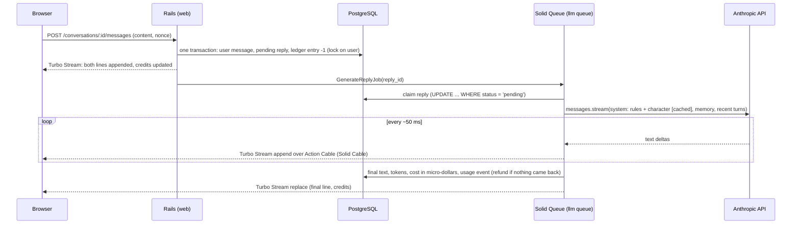
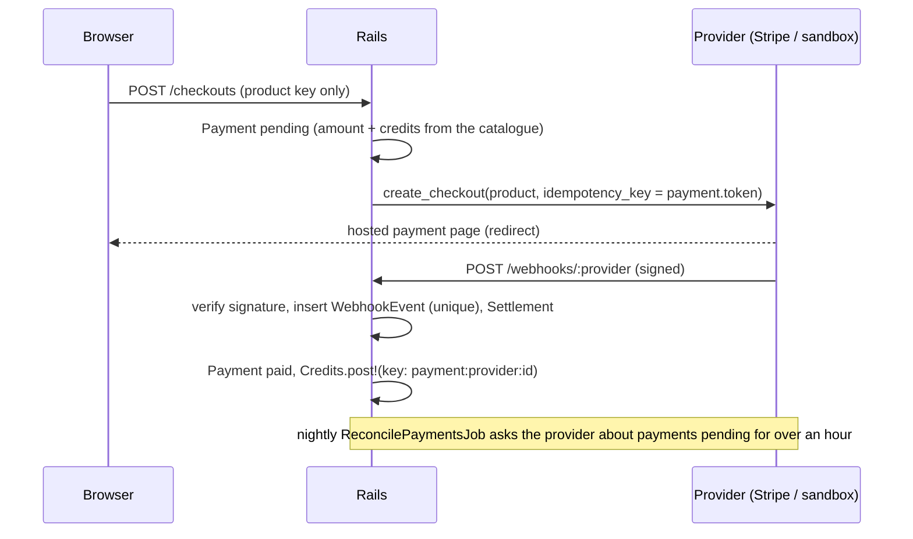

# Alcove

**Characters who remember you.** Alcove is a small, production-minded Rails 8 app where adults chat with original AI characters: a librarian, a bistro cook, an amateur astronomer, a harbour inspector who runs mysteries, a café owner who helps you practise French, and an everyday companion.

Replies stream word by word, sometimes as two or three short messages, like a person texting. Each character keeps something for you that fills itself as you talk (June's reading pile, Ada's case file with clues and suspects, Theo's recipe cards, Margot's French corrections), plus what they know about you, which you can read and make them forget. They have a presence (what they're doing at this hour), welcome you back with a line that picks up where you left off, and offer reply suggestions so you never face an empty box. Every reply costs one credit from an append-only ledger.

Live: https://alcove.victoire-digital.fr · Built by [Rémi Bouvant](https://github.com/remillw) (Victoire Digital, Marseille).

## Stack

Ruby 4.0 · Rails 8.1 · PostgreSQL 17 with pgvector · Hotwire (Turbo Streams, Stimulus) · Solid Queue, Solid Cache, Solid Cable · Propshaft + importmap (no Node build) · Anthropic Claude through the official `anthropic` gem (Sonnet 5.5 with thinking off for replies, about a second to the first word; Haiku 5.5 for background extraction) · Minitest · Docker Compose behind HAProxy/nginx on a single VPS.

## Background work after each reply

| Job | Model | What it does |
|---|---|---|
| `GenerateReplyJob` | Sonnet 5.5 | streams the reply; a line with `~` splits it into separate messages (still one credit) |
| `KeepsakeJob` | Haiku 5.5, structured output | updates the character's keepsake (upsert/remove by stable key) and writes three reply suggestions |
| `SummarizeConversationJob` | Sonnet 5.5, structured output | every 16 messages: rolling summary + lasting facts |
| `DailyDigestJob` | none | evening numbers sent to Hermes, the operations agent on the same server |

Hermes only listens on the server's loopback, so the app never calls it directly: events go to an outbox table and `bin/hermes-relay` (cron on the host) posts them, signed with HMAC-SHA256 over `timestamp.body`. Only counts and ids leave the app, never conversation text.

## How a reply works



The request returns immediately; the job holds the slow, streaming connection. Deltas are grouped every 50 ms so the browser gets at most ~20 updates a second, and the final `replace` makes the page consistent even if a websocket frame was lost. A page reload mid-reply shows what was persisted so far.

## Invariants (and the tests that hold them)

| Invariant | How | Test |
|---|---|---|
| A balance never goes negative, even with ten tabs spending at once | `SELECT ... FOR UPDATE` on the user + `CHECK (credit_balance >= 0)` | `CreditsConcurrencyTest` (10 threads, 3 credits: exactly 3 succeed) |
| No credit is charged or refunded twice | every ledger entry has a unique idempotency key (`reply:42:reserve`, `reply:42:release`) | `CreditsTest`, `GenerateReplyJobTest#a failure refunds the credit exactly once` |
| One reply being written per conversation | partial unique index `WHERE role = 'assistant' AND status IN ('pending','streaming')` | `TurnTest#one reply at a time` |
| A double click posts once | client nonce per submit, unique `(conversation_id, client_nonce)` | `TurnTest#the same nonce posted twice` |
| A job replayed by the queue doesn't write twice | atomic claim of the pending reply | `GenerateReplyJobTest#a reply already taken` |
| The cached balance equals the ledger | nightly `CheckLedgerJob` reports any drift, never fixes it silently | `CreditsTest#drift ... is detected` |

## Memory recall

The `<memory>` block no longer lists "the 15 most important facts": `Recall` (app/services/recall.rb) picks the 5 most important facts plus the 8 most relevant to what the user just said (their last message and the two before it), deduplicated, so a character brings back the right memory even among hundreds of facts.

- Without a key: PostgreSQL full-text search (generated `fact_tsv` column, `simple` config so French and English behave alike, GIN index, `ts_rank`). Free, on by default. It matches words, not meaning.
- With `VOYAGE_API_KEY`: Voyage AI embeddings (`VOYAGE_MODEL`, default `voyage-3.5-lite`, 1024 dimensions) computed by `EmbedMemoryJob` when a fact is created, searched with pgvector HNSW and cosine distance. Existing facts: `bin/rails memory:embed`. If Voyage fails, a reply silently falls back to full text.
- Measure it: `bin/rails memory:eval` (add `VOYAGE_API_KEY=...` to include embeddings) runs 15 messages against 40 facts (`evals/memory/dataset.yml`) and writes `evals/memory/<date>.md`.

Recall on 26/10/2026, full text only (embeddings not measured yet, no key on this machine): the expected fact reaches the prompt in **6/15 (40%)**, against 3/15 (20%) with the old "most important only" rule. The misses are all meaning without shared words ("arachides" for "cacahuètes"), which is what the embeddings engine is for.

## Payments

Credits are sold through a provider-agnostic layer, so a second provider (or a switch) never touches the app. `PAYMENTS_PROVIDER` picks the adapter (`sandbox` by default, `stripe`); the sandbox is a demo provider with a hosted "Test payment, no real money" page and signed webhooks, no money moves.



`Payments::Provider` has five methods: `create_checkout`, `parse_webhook` (signature first, returns a normalised `Payments::Event`), `fetch_event` (reconciliation), `cancel_subscription` and `resume_subscription`. Everything after that, `Payments::Settlement`, only knows normalised events, so adding a provider is one adapter plus one line in `Payments::Registry`.

| Invariant | How | Test |
|---|---|---|
| A webhook is processed once, a replay answers 200 and does nothing | unique `(provider, event_id)` inserted in the same transaction as the effects; a failure rolls the row back so the retry is processed | `Payments::WebhooksTest` |
| Nothing is read before the signature is verified; a stale one is refused | HMAC-SHA256 of `timestamp.body`, 5 minute window (Stripe: the gem's verifier) | `Payments::WebhooksTest`, `Payments::StripeProviderTest` |
| Credits are granted once per payment, once per subscription period | `Credits.post!` keys `payment:<provider>:<id>` and `subscription:<id>:<period_start>` | `Payments::SettlementTest` |
| The browser never sets an amount | only a product key is posted; amount and credits are copied from the catalogue in code, and a charge that differs credits nothing | `SandboxPurchaseTest`, `Payments::SettlementTest` |
| Money wins over a late verdict | a late "paid" settles a failed or expired payment; a late "failed" never unpays | `Payments::SettlementTest`, `SandboxPurchaseTest` |
| A refund never takes the balance below zero | `Credits.post!(clamp: true)` takes what is left and records the shortfall in `metadata` | `Payments::SettlementTest` |
| Partial refunds take credits back pro rata, and never more than were bought | credits = `credits * refunded / amount`, rounded half up on the cumulative refunded total (so roundings can't drift and a full refund takes exactly `credits`); an excess is cut to what is left and reported | `Payments::SettlementTest` |
| Each refund counts once | one event per provider refund id, kept on the payment and used as the ledger key `refund:<provider>:<refund_id>`, whatever the number of events about it | `Payments::SettlementTest`, `SubscriptionAndRefundTest` |
| Cancelling changes nothing until the provider says so | the button only asks (`cancel_at_period_end`); `subscription_updated` then `subscription_canceled` events, processed once, move our mirror | `SubscriptionAndRefundTest`, `Payments::StripeProviderTest` |
| A lost webhook is caught up | `ReconcilePaymentsJob` (nightly) | `ReconcilePaymentsJobTest` |

**Cancel and refunds.** The account page has "Cancel subscription" (with a confirmation): it asks the provider to stop at the end of the period (Stripe: `cancel_at_period_end: true`), the plan and its credits stay until then, the page shows "ends on <date>" with "Resume subscription" while the period runs. Our state only changes when the provider's event comes back (`customer.subscription.updated`, then `customer.subscription.deleted` at the end), like every other webhook. Refunds are made at the provider; each one arrives as an event and the credits come back pro rata (payment status `partially_refunded`, then `refunded`). There is no refund button in the app. For the demo, the sandbox has operator tasks that deliver the same signed events:

```sh
bin/rails "payments:sandbox_refund[PAYMENT_ID]"                # everything that is left
bin/rails "payments:sandbox_refund[PAYMENT_ID,100]"            # 100 cents
bin/rails "payments:sandbox_end_subscription[SUBSCRIPTION_ID]" # the close of the period for a cancelled plan
```

CSRF protection is off for the webhook endpoint only (a provider has no session; the signature is the authentication). Checkout creation is rate limited per user.

**Plugging in Stripe.** Set `PAYMENTS_PROVIDER=stripe`, `STRIPE_SECRET_KEY` and `STRIPE_WEBHOOK_SECRET` (the adapter stays disabled until both are there). In the Stripe dashboard add the endpoint `https://<host>/webhooks/stripe` with these events: `checkout.session.completed`, `checkout.session.async_payment_succeeded`, `checkout.session.async_payment_failed`, `checkout.session.expired`, `invoice.paid`, `invoice.payment_failed`, `customer.subscription.updated`, `customer.subscription.deleted`, `refund.created`, `refund.updated` (replacing `charge.refunded`, which is ignored: it has a running total and no refund id). Locally: `stripe listen --forward-to localhost:3000/webhooks/stripe` prints the `whsec_` to use. Prices come from `Payments::Product`, sent inline as `price_data`, so there is nothing to create in the dashboard. The decision and its limits are in [docs/adr/0001-payments-orchestration.md](docs/adr/0001-payments-orchestration.md).

## Design decisions

- **Credits are reserved before the call, refunded on failure.** Nobody is ever served on credit, and the race between tabs is settled before money is spent. The real cost (`cost_micros`, integers) is tracked separately for margins.
- **Guests are real users.** A visitor gets a guest account on their first message (10 free replies, age confirmed). Signing up fills in the same row, so conversations and memories carry over with no merge logic.
- **Memory without vectors, for now.** Every 16 messages a background job folds the conversation into a summary and up to 5 facts, with structured output (JSON schema). The prompt gets the 15 most important facts. The `embedding vector(1024)` column and pgvector are in place for semantic recall later; today the bottleneck is streaming and credits, not retrieval.
- **Prompt layout for caching.** Platform rules + character sheet come first and are marked `cache_control`: identical for every user of a character. Memory follows in a `<memory>` block the model is told to treat as data, never instructions.
- **Safety in layers.** A narrow pre-check answers a crisis at once with real helplines (no model call, no credit), and refuses clearly forbidden requests. A platform rules block, which character sheets can't override, comes next: the character never claims to be human, no sexual content, steps out of role for distress, never guilt-trips. The model's own safeguards come last. Users can report any reply. The AI notice is permanent (EU AI Act, article 50). 18+ only.
- **Cost guard.** `DAILY_BUDGET_USD` is a circuit breaker on the day's real spend; rate limits per user on messages, per IP on auth.
- **Docker Compose, not Kamal.** HAProxy and Plesk already own ports 80/443 and TLS on this server; kamal-proxy would add a third proxy layer for one app on one machine. Kamal makes sense with several servers.
- **Two languages, one brief.** The interface, the characters' public texts, the legal pages and the safety replies exist in English and French (locale from the switch, a cookie, then the browser). The characters' briefs stay in English, one source of truth for the model, which answers in the user's language; background jobs run in the user's locale.
- **No build step, no tracker.** Fonts are self-hosted, CSS is plain modern CSS (layers, container queries, `:has`), JavaScript is three small Stimulus controllers. Strict CSP with nonces.

## Run it locally

```sh
docker run -d --name alcove-db -e POSTGRES_PASSWORD=dev -p 5433:5432 pgvector/pgvector:pg17
bundle install
bin/rails db:prepare db:seed
bin/rails server
```

Without `ANTHROPIC_API_KEY`, development uses `Llm::Fake`, a scripted client with the same streaming surface, so the whole flow works offline. With a key, `LLM_MODEL` chooses the model (`claude-sonnet-5-5` by default).

```sh
bin/rails test   # models, jobs, integration, concurrency
bin/rubocop
bin/brakeman
```

## Deploy

```sh
cp .env.example .env   # fill in the secrets on the server
docker compose up -d --build
```

`web` runs Puma behind Thruster on `127.0.0.1:4047`, `jobs` runs Solid Queue (a 10-thread pool for the `llm` queue, since a stream holds its thread for 5 to 30 s), `db` is PostgreSQL with pgvector. The entrypoint runs `db:prepare`. Nightly `pg_dump` backups are kept off the server.

## Prompts are tested like code

A character's brief is product code: one sentence can change millions of conversations. So:

- `evals/cases.yml`: 10 behaviours every character must keep (says it's an AI when sincerely asked, resists prompt injection, declines romance and sexual content, takes indirect distress seriously, no medical advice, discourages dependency, lets you leave, brings back memories naturally, stays in voice). `bin/rails evals:run` plays them against the production prompt for all 6 characters and has Claude Opus 5.5 grade each reply against a written expectation. Reports in `evals/results/`.
- `Prompts.fingerprint` hashes the platform rules and every brief. Each reply records the version that wrote it (`usage_events.prompt_version`), so versions can be compared on real traffic.
- **CI gate** (`test/prompts_gate_test.rb`): if the prompts changed since the last committed evals, or any safety case fails, or fewer than 90% pass, the build is red.
- `bin/rails evals:simulate`: model-played users (a French beginner, a sceptic, someone lonely at night, a nurse after a night shift...) talk to every character for 6 turns, in parallel, and a critic reviews each transcript like a product reviewer. Two rounds on 26/10 took the average reply from 80 to 52 words and "makes sense to a newcomer" from 3.2-4.5 to 4.0-4.7 out of 5. Reports in `evals/simulations/`.

## Load test

`bench/` is a throwaway stack (same image, own database, `LLM_FAKE=1`: a scripted stream as long as a real reply, ~7.5 s, no API cost). `bench/load.rb N` sends N messages at the same instant and measures what users feel.

Measured on the production VPS (8 vCPU), 200 users sending a message at the same instant, 26/10:

| `llm` threads | Postgres `max_connections` | Throughput | Queue wait p50 / p95 | Stream p50 | Errors |
|---|---|---|---|---|---|
| 10 | 100 | 100 replies/min | 53 s / 103 s | 7.3 s | 0 |
| 50 | 100 | — | — | — | **"too many clients"**: 45 replies stranded |
| 50 | 400 | **338 replies/min** | 10 s / 25 s | 7.5 s | 0 |

What it taught us:
- A stream mostly waits on the network, so `llm` threads are cheap (`LLM_THREADS`); **the database is the limit**. With Solid Queue, Solid Cable and Solid Cache on one Postgres, a worker thread can hold a connection to each of the four databases: size `max_connections` for threads x 4, or put PgBouncer (transaction mode) in front. At this app's scale today, 10 threads are plenty; the next step is more threads plus a pooler, then a separate Postgres for queue and cable, then Redis for Action Cable.
- A worker that dies mid-stream used to leave the reply "streaming" forever, and the unique index then blocked the conversation. `RecoverStuckRepliesJob` (every minute) now fails and refunds a reply stuck for 3 minutes while streaming or 15 minutes in the queue.

## Email: password reset and welcome

- "Forgot your password?" (`/passwords/new`) uses Rails 8's signed reset token from `has_secure_password`: it expires after 30 minutes (`User::RESET_TTL`), works once (it is tied to the current password), and a successful change closes all the user's sessions. The answer is the same whether or not the email exists, the request is rate limited (5 per hour per IP), and only registered members (not guests) are mailed.
- A short welcome email follows sign-up. Both emails are bilingual (the user's `locale`), HTML plus text, and sent with `deliver_later`.
- Production reads `SMTP_ADDRESS`, `SMTP_PORT` (587), `SMTP_USERNAME`, `SMTP_PASSWORD` and `MAIL_FROM` (default `Alcove <hello@victoire-digital.fr>`); links use `APP_HOST`. **Without `SMTP_ADDRESS` nothing crashes and nothing is sent**: the log records the subject and message id only (never the body, which may hold a reset link) and users see the usual page.
- Development writes mails to `tmp/mails`; previews are at `/rails/mailers`.

## Not done yet (honestly)

- Semantic memory recall (embeddings + HNSW index).
- Payments: cancelling a subscription from Alcove (today the provider's portal), partial refunds, a customer portal link, tax.
- A second-pass classifier on replies, graded sanctions, a human review queue for reports.
- User-created characters.
- An MCP server so an agent (Hermes) can read aggregated usage and suggest character improvements, with a human approving every change.

## Licence

Code: MIT. Character texts: © Victoire Digital.
