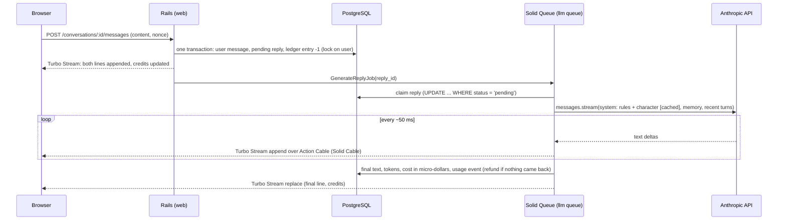

# Alcove

**Characters who remember you.** Alcove is a small, production-minded Rails 8 app where adults chat with original AI characters: a librarian, a bistro cook, an amateur astronomer, a harbour inspector who runs mysteries, a café owner who helps you practise French, and an everyday companion.

Replies stream word by word, sometimes as two or three short messages, like a person texting. Each character keeps something for you that fills itself as you talk (June's reading pile, Ada's case file with clues and suspects, Theo's recipe cards, Margot's French corrections), plus what they know about you, which you can read and make them forget. They have a presence (what they're doing at this hour), welcome you back with a line that picks up where you left off, and offer reply suggestions so you never face an empty box. Every reply costs one credit from an append-only ledger.

Live: https://alcove.victoire-digital.fr · Built by [Rémi Bouvant](https://github.com/remillw) (Victoire Digital, Marseille).

## Stack

Ruby 4.0 · Rails 8.1 · PostgreSQL 17 with pgvector · Hotwire (Turbo Streams, Stimulus) · Solid Queue, Solid Cache, Solid Cable · Propshaft + importmap (no Node build) · Anthropic Claude through the official `anthropic` gem (Sonnet 5.5 with thinking off for replies, about a second to the first word; Haiku 5.5 for background extraction) · Minitest · Docker Compose behind HAProxy/nginx on a single VPS.

## Background work after each reply

| Job | Model | What it does |
|---|---|---|
| `GenerateReplyJob` | Sonnet 5.5 | streams the reply; a line with `~` splits it into separate messages (still one credit) |
| `KeepsakeJob` | Haiku 5.5, structured output | updates the character's keepsake (upsert/remove by stable key) and writes three reply suggestions |
| `SummarizeConversationJob` | Sonnet 5.5, structured output | every 16 messages: rolling summary + lasting facts |
| `DailyDigestJob` | none | evening numbers sent to Hermes, the operations agent on the same server |

Hermes only listens on the server's loopback, so the app never calls it directly: events go to an outbox table and `bin/hermes-relay` (cron on the host) posts them, signed with HMAC-SHA256 over `timestamp.body`. Only counts and ids leave the app, never conversation text.

## How a reply works



The request returns immediately; the job holds the slow, streaming connection. Deltas are grouped every 50 ms so the browser gets at most ~20 updates a second, and the final `replace` makes the page consistent even if a websocket frame was lost. A page reload mid-reply shows what was persisted so far.

## Invariants (and the tests that hold them)

| Invariant | How | Test |
|---|---|---|
| A balance never goes negative, even with ten tabs spending at once | `SELECT ... FOR UPDATE` on the user + `CHECK (credit_balance >= 0)` | `CreditsConcurrencyTest` (10 threads, 3 credits: exactly 3 succeed) |
| No credit is charged or refunded twice | every ledger entry has a unique idempotency key (`reply:42:reserve`, `reply:42:release`) | `CreditsTest`, `GenerateReplyJobTest#a failure refunds the credit exactly once` |
| One reply being written per conversation | partial unique index `WHERE role = 'assistant' AND status IN ('pending','streaming')` | `TurnTest#one reply at a time` |
| A double click posts once | client nonce per submit, unique `(conversation_id, client_nonce)` | `TurnTest#the same nonce posted twice` |
| A job replayed by the queue doesn't write twice | atomic claim of the pending reply | `GenerateReplyJobTest#a reply already taken` |
| The cached balance equals the ledger | nightly `CheckLedgerJob` reports any drift, never fixes it silently | `CreditsTest#drift ... is detected` |

## Design decisions

- **Credits are reserved before the call, refunded on failure.** Nobody is ever served on credit, and the race between tabs is settled before money is spent. The real cost (`cost_micros`, integers) is tracked separately for margins.
- **Guests are real users.** A visitor gets a guest account on their first message (3 free replies, age confirmed). Signing up fills in the same row, so conversations and memories carry over with no merge logic.
- **Memory without vectors, for now.** Every 16 messages a background job folds the conversation into a summary and up to 5 facts, with structured output (JSON schema). The prompt gets the 15 most important facts. The `embedding vector(1024)` column and pgvector are in place for semantic recall later; today the bottleneck is streaming and credits, not retrieval.
- **Prompt layout for caching.** Platform rules + character sheet come first and are marked `cache_control`: identical for every user of a character. Memory follows in a `<memory>` block the model is told to treat as data, never instructions.
- **Safety in layers.** A narrow pre-check answers a crisis at once with real helplines (no model call, no credit), and refuses clearly forbidden requests. A platform rules block, which character sheets can't override, comes next: the character never claims to be human, no sexual content, steps out of role for distress, never guilt-trips. The model's own safeguards come last. Users can report any reply. The AI notice is permanent (EU AI Act, article 50). 18+ only.
- **Cost guard.** `DAILY_BUDGET_USD` is a circuit breaker on the day's real spend; rate limits per user on messages, per IP on auth.
- **Docker Compose, not Kamal.** HAProxy and Plesk already own ports 80/443 and TLS on this server; kamal-proxy would add a third proxy layer for one app on one machine. Kamal makes sense with several servers.
- **No build step, no tracker.** Fonts are self-hosted, CSS is plain modern CSS (layers, container queries, `:has`), JavaScript is three small Stimulus controllers. Strict CSP with nonces.

## Run it locally

```sh
docker run -d --name alcove-db -e POSTGRES_PASSWORD=dev -p 5433:5432 pgvector/pgvector:pg17
bundle install
bin/rails db:prepare db:seed
bin/rails server
```

Without `ANTHROPIC_API_KEY`, development uses `Llm::Fake`, a scripted client with the same streaming surface, so the whole flow works offline. With a key, set `LLM_MODEL` to choose the model (`claude-opus-5-5` by default, `claude-haiku-5-5` for a much lower cost per reply).

```sh
bin/rails test   # models, jobs, integration, concurrency
bin/rubocop
bin/brakeman
```

## Deploy

```sh
cp .env.example .env   # fill in the secrets on the server
docker compose up -d --build
```

`web` runs Puma behind Thruster on `127.0.0.1:4047`, `jobs` runs Solid Queue (a 10-thread pool for the `llm` queue, since a stream holds its thread for 5 to 30 s), `db` is PostgreSQL with pgvector. The entrypoint runs `db:prepare`. Nightly `pg_dump` backups are kept off the server.

## Capacity, back of the envelope

A reply streams for about 8 s on average, so one `llm` thread writes ~7 replies a minute and the default pool ~70. Solid Cable polls every 100 ms. The next steps, in order, would be more `jobs` processes, then a dedicated Postgres for queue and cable, then Redis for Action Cable if fan-out grows.

## Not done yet (honestly)

- Semantic memory recall (embeddings + HNSW index).
- Paid plans with Stripe (top-ups, subscription, webhooks idempotent on `event.id`).
- A second-pass classifier on replies, graded sanctions, a human review queue for reports.
- Password reset by email, French version, user-created characters.
- An MCP server so an agent (Hermes) can read aggregated usage and suggest character improvements, with a human approving every change.

## Licence

Code: MIT. Character texts: © Victoire Digital.
